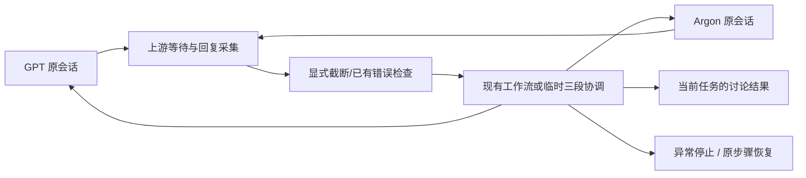

# AI 协作工作台 V1：技术调研与实施方案

研究日期：2026-10-20（Asia/Shanghai）  
修订日期：2026-10-20；依据用户补充的实际使用情况收窄验证范围。  
状态：本次仅更新技术报告，未执行新的账号实验或修改应用代码。此前研究与隔离验证结果保留。

## 1. 推荐决策

**推荐沿用 Multi-AI Chat Desktop，先验证 GPT → Argon → GPT 的完整通信闭环，仅为实际缺口增加小型协调逻辑。保留网页切换、会话状态保存和上游回复等待机制。是否 Fork、需要改多少代码，在这轮小范围验证后决定。**

### 已接受的使用事实与边界

- **[事实·用户确认]** Multi-AI Chat 已支持网页切换和会话状态保存，直接沿用。不再验证多个 AI 网页同时显示，也不重建窗口布局或会话保存系统。
- **[事实·用户确认]** Gemini Argon 的自定义 GitHub MCP 读写已经可用，偶尔需要重新关联或授权。不重复测试基础 GitHub 能力；此前关于仓库导入功能的限制不适用于这套已验证的 MCP。
- **[事实·用户确认 + 本地源码]** 上游已有回复完成等待机制，继续使用。截断问题属于传输完整性缺陷，不据此重做等待逻辑或构建通用语义判断引擎。
- **[用户指定]** 默认 GPT 负责 GitHub 写操作，Argon 主要独立审计。工作台不新增 GitHub 写操作审批；原生平台强制的授权按其原有机制处理。

### 本次验证只回答四个问题

1. 截断回复被当成成功结果的精确条件是什么，能否在现有接收边界用小修复阻断？
2. GPT 的完整回复能否自动交给 Argon，Argon 的完整审计回复能否回到 GPT，最终讨论结果能否返回当前任务？
3. 上述往返是否持续使用原来的两个网页会话，不新开线程、不重放整段历史、不串任务？
4. 截断、人工暂停、发送结果不明确或 MCP 重新关联时，能否停止后续发送，并在处理后继续正确的一步？

**删除基础 GitHub 动作矩阵、模型可用性、网页登录、普通浏览器与 WebView 对照、多网页同时显示等前置验收。** 真实任务中遇到关联失效，按异常停止/恢复处理，不重启整套能力调研。当前也不新增数据库、通用审批系统、分块协议、跨平台测试或正式应用骨架。

## 2. 证据口径与本轮实际完成

本文使用以下标签：

- **[事实·本地]**：本轮直接读取的源码、配置、命令执行结果或隔离模块实验。
- **[事实·文档]**：官方资料或上游维护者记录的内容。说明“资料这样记载”，不等于本机验证。
- **[事实·用户确认]**：用户已实际验证的能力，作为本计划输入接受；不冒充本代理实测，也不安排重复基础测试。
- **[推断]**：依据源码或文档作出的工程判断。
- **[待测]**：需要真实网页、账号或原生构建才能确认。
- **[设计]**：建议采用的实现或验收要求，尚未开发。

### 固定研究版本

| 项目 | 本轮源码版本 | 发布与许可 |
|---|---|---|
| Multi-AI Chat Desktop | `6bcf904dfce890f7ebe198cbfc329bf8d685ce62` | 本轮 GitHub API 查询 latest release 为 v1.9.6；源码已有 v1.9.7 候选修复；MIT |
| Agent HUD Open | `014524cd0dbed4d3bab4f715a847fcbeb4a7d0f3` | latest release 为 v0.5.5；Apache-2.0 |

**不要把上述主分支源码的测试结果，套用到 v1.9.6 安装包。** 两者不是同一版本。上游源码的 package/Cargo 版本为 `0.0.0`，发布版本通过发布流程处理，不能据此认定未发布或无版本管理。

本轮在仓库外克隆上游，未修改其已跟踪源码，未登录 AI 网页，未使用账号密钥，未写 GitHub，也未向 ChatGPT 发调研请求。最初 prodex 检查因专用浏览器未运行失败，随后按用户“本轮不要 GPT”的指示改为直接检索。

本机隔离验证：

| 验证 | 结果 | 能证明什么 |
|---|---|---|
| `pnpm install --frozen-lockfile` | 成功 | 当前 Windows/Node 下 JS 依赖可安装 |
| `pnpm verify` | 成功：63 个测试文件、781 个测试；另 22 个 agent 工具测试；类型、lint、注入脚本、adapter schema 均通过 | 上游自动验证基线可复现 |
| `pnpm build` | 成功；有大于 500 kB chunk 警告 | Vite 前端生产资源可构建 |
| `node scripts/agent/doctor.mjs --json` | `missing_prerequisites` | 当前未找到 cargo/rustc；C++ 工具已发现 |
| 回复完整性模块实验 | 复现截断仍成功返回 | 上游工作流缺少截断拒绝门禁，详见 §4 |
| Rust 单测、Tauri 编译、NSIS、真实账号聊天/工具 | 未执行 | 不能据前端通过宣称这些能力已验收 |

验证日志附于 [research-evidence](./research-evidence/README.md)。原始临时实验目录为 `C:\Users\Administrator\AppData\Local\Temp\ai-one-research-155195dc`。

## 3. Multi-AI Chat 实际架构与复用边界

### 3.1 运行链路

**[事实·本地]** 当前配置是 React 18 + TypeScript + Zustand + Vite 6，宿主 Tauri 2 + Rust；Windows WebView2。Tauri child webviews 使用 `unstable` feature。桌面壳不是 Electron，也不是网页 iframe。

实际消息链路：

```text
本地 React 控制台
  → workflow / sendAndWait
  → host.provider.send
  → Rust WebView eval
  → injected engine：填输入框、触发发送、识别当前轮、观察 DOM
  → injected bootstrap：outbox + bootId + mid
  → title 状态提示 + eval_with_callback 拉取正文 + ack
  → TypeScript bridge bus
  → waitForResponse
  → 下一工作流步骤
```

`docs/ARCHITECTURE.md` 中早期讨论过 sentinel navigation，文档已记载后来切为 callback pull；实际代码也是 pull，不应继续引用早期 sentinel 方案描述当前实现。

来源：[宿主 webviews.rs](https://github.com/TED-H-com/multi-ai-chat-desktop/blob/6bcf904dfce890f7ebe198cbfc329bf8d685ce62/src-tauri/src/webviews.rs)、[bootstrap.ts](https://github.com/TED-H-com/multi-ai-chat-desktop/blob/6bcf904dfce890f7ebe198cbfc329bf8d685ce62/injected/bootstrap.ts)、[pull.ts](https://github.com/TED-H-com/multi-ai-chat-desktop/blob/6bcf904dfce890f7ebe198cbfc329bf8d685ce62/src/bridge/pull.ts)。

### 3.2 网页适配与收发

**[事实·本地]**

- provider JSON 提供页面地址、输入框、发送按钮、回复、登录、思考与停止选择器，以及输入策略和延迟。
- ChatGPT adapter v9 用 ProseMirror paste；Gemini adapter v2 用 Quill/Angular 输入策略。
- engine 不只是简单 `innerText` 抓取：有发送确认、当前用户轮定位、基线回复排除、流式观察、轮询、最终重读和 Markdown 序列化。
- ChatGPT 有专门完成门禁：当前回复/轮次/终态控件稳定、无思考或强活动；最少 3 次采样、稳定至少 1.2 秒。
- `TURN_COMPLETION_SIGNALS` 当前只给 ChatGPT 定义了相应终态结构。Gemini 主要依赖 thinking selectors 和完成延迟，未看到 Argon Task 工具生命周期专用实现。
- 传输有 bootId、mid、peek/ack 去重；其身份粒度不足以直接支持一个 provider 多个网页会话并行路由。
- 工作流响应等待按 provider 匹配 `RESPONSE_DONE`。内部虽有 turn 计数，完成事件处理没有校验独立的持久 `dispatchId + bindingVersion + nativeTurnId`。

**[设计·修订]** 以上保留为源码观察，不构成重写等待器的理由。本轮直接消费上游完成事件；只有闭环中实际出现失配，才建立对应的具体回归用例。先修显式截断标记被忽略的问题，不扩展为逐平台的通用工具终态分析。

来源：[engine.ts](https://github.com/TED-H-com/multi-ai-chat-desktop/blob/6bcf904dfce890f7ebe198cbfc329bf8d685ce62/injected/engine.ts)、[ChatGPT adapter](https://github.com/TED-H-com/multi-ai-chat-desktop/blob/6bcf904dfce890f7ebe198cbfc329bf8d685ce62/adapters/chatgpt.json)、[Gemini adapter](https://github.com/TED-H-com/multi-ai-chat-desktop/blob/6bcf904dfce890f7ebe198cbfc329bf8d685ce62/adapters/gemini.json)、[waitForResponse.ts](https://github.com/TED-H-com/multi-ai-chat-desktop/blob/6bcf904dfce890f7ebe198cbfc329bf8d685ce62/src/workflow/waitForResponse.ts)。

### 3.3 工作流、多轮与暂停

**[事实·本地]**

- 图执行器已有 step、fanout、loop、条件边、角色绑定及 checkpoint 等原语。
- Consult 的首轮可并行让两个角色先回答，适合改造成“先独立取证、再互看”的起点。
- Debate 仍是预设 pro → con → judge → summary；Roundtable 是 4 个席位 × 5 轮的固定串行图。不是达到证据共识才终止的协商器。
- checkpoint 支持确认草稿、skip、native-edit；native-edit 将草稿填入网页后等待用户发送。
- cancel 会中止工作流并尝试点击网页停止；这是取消机制，不是可随时暂停、持久保存并继续的完整状态机。
- 等待逻辑已有活动刷新和时间界限：10 分钟无活动、60 分钟单步绝对上限。审批等待不应简单复用这些规则后当成功完成。

**[设计·修订]** 先用现有 `sendAndWait`、preflight、错误处理、取消和恢复入口验证固定的三段交接。只有现有流程无法表达的“下一步发给谁、停止后从哪里继续”才允许用临时协调脚本补齐；不先建设完整持久状态机。保留 free mode，不重构旧工作流。

来源：[executor.ts](https://github.com/TED-H-com/multi-ai-chat-desktop/blob/6bcf904dfce890f7ebe198cbfc329bf8d685ce62/src/workflow/graph/executor.ts)、[consultGraph.ts](https://github.com/TED-H-com/multi-ai-chat-desktop/blob/6bcf904dfce890f7ebe198cbfc329bf8d685ce62/src/workflow/graph/consultGraph.ts)、[roundtableGraph.ts](https://github.com/TED-H-com/multi-ai-chat-desktop/blob/6bcf904dfce890f7ebe198cbfc329bf8d685ce62/src/workflow/graph/roundtableGraph.ts)、[checkpoint.ts](https://github.com/TED-H-com/multi-ai-chat-desktop/blob/6bcf904dfce890f7ebe198cbfc329bf8d685ce62/src/workflow/checkpoint.ts)、[cancel.ts](https://github.com/TED-H-com/multi-ai-chat-desktop/blob/6bcf904dfce890f7ebe198cbfc329bf8d685ce62/src/workflow/cancel.ts)。

### 3.4 沿用会话保存，检查交接是否仍在原会话

**[事实·本地]**

- Windows 每 provider 有持久 profile，可保存该 WebView 的登录状态；并不是读取现有 Chrome 的登录状态。
- 本地 `ConversationSession` 保存消息、模式等，没有原生网页会话 URL 与 threadId 绑定字段。
- `ensureFreshProviderSessions` 是本地历史切换后的新建 provider 会话路径；它与在当前任务中切换可见的 provider 网页不是同一操作，不能将两者混为一谈。
- 历史注入最多 16 条，每条最多 2,500 字符，总共最多 12,000 字符，存在截断。
- `SessionCheckpoint` 主要保存 graphId/version、questionHash、stepIndex、待确认节点和时间。
- startup checkpoint 用于提示未完成任务、提供匹配 snapshot 的重放；`replaySnapshot` 再次执行图。不能等价于恢复在途工具调用，也不能直接用于有写操作的无脑续跑。

**[设计·修订]** 接受用户确认的既有会话保存机制，优先在当前已有两个网页线程中完成往返。本轮只记录会话 URL/已有 ID、各次交接位置，检查协调过程是否误触新会话或历史重放。不因源码存在其他恢复路径就重建绑定、保存或恢复系统。主动换成新会话及完整历史交接仍是产品后续需求，不列入本次闭环验证。

来源：[conversationSessions.ts](https://github.com/TED-H-com/multi-ai-chat-desktop/blob/6bcf904dfce890f7ebe198cbfc329bf8d685ce62/src/ui/conversationSessions.ts)、[conversationContinuity.ts](https://github.com/TED-H-com/multi-ai-chat-desktop/blob/6bcf904dfce890f7ebe198cbfc329bf8d685ce62/src/ui/conversationContinuity.ts)、[sessionCheckpoint.ts](https://github.com/TED-H-com/multi-ai-chat-desktop/blob/6bcf904dfce890f7ebe198cbfc329bf8d685ce62/src/workflow/sessionCheckpoint.ts)、[replay.ts](https://github.com/TED-H-com/multi-ai-chat-desktop/blob/6bcf904dfce890f7ebe198cbfc329bf8d685ce62/src/workflow/snapshot/replay.ts)。

## 4. 已复现的完整性缺口与维护风险

### 4.1 截断回复会通过等待函数

**[事实·本地，模块级复现]**

`PULL_MAX_DECODED_BYTES = 1,048,576`，outbox 上限为 10 MiB。`capOutboxEntry` 会缩短超限 payload 并标记 `truncated:true`。然而 `waitForResponse.payloadText` 对对象提取 `.text`，没有拒绝该标记。

本轮使用未修改的上游 `capOutboxEntry → bridge bus → waitForResponse`，只 mock 宿主轮询：

| 观察 | 值 |
|---|---:|
| 原始 UTF-8 字节 | 2,850,013 |
| 原始 JS 字符长度 | 1,050,013 |
| 截断标记 | true |
| waiter 是否成功 resolve | true |
| 返回字符长度 | 332,229 |
| 原文末尾校验标记是否保留 | false |

这证明这一条模块路径可接受不完整回复；**不是声称已经在真实网页中跑出同一失败**。`runStep` 主要检查 `[Error: ...]` 文本，现有路径不能作为 V1 完整性的保证。

**问题定性：网页生成结束与传输完整是两件事。** 这里复现的是“已完成回复在传输时被截短，随后仍被接收为成功”，不是“上游不会等网页回复完成”。

**[事实·本地，源码复核]** 精确的裁剪条件是 `UTF8(JSON.stringify(entry)).length > PULL_MAX_DECODED_BYTES - 2`，不是正文字符数超过一百万。JSON 元数据、转义与多字节文本都占空间；每次裁剪约保留当前字符串的 75%。bootstrap 还会产生 `done_truncated` 降级状态。此前模块实验绕过了实际宿主轮询，因此仍要补一条带真实 pull/状态顺序的集成回归，确认整个工作流是否继续派发；不能仅凭模块 resolve 就声称真实 GUI 已经转发。

**[设计·最小修复候选，未实施]**

1. 在 `waitForResponse` 接收 `RESPONSE_DONE`、调用 `payloadText` 之前检查 `payload.truncated === true`。无论 payload 是否还有 `.text`，都拒绝作为成功回复。
2. 使用现有 `ProviderResponseError` 分类返回“回复传输被截断”，保留原网页供查看；不另建等待器、不改变 thinking selectors、完成延迟或原生停止按钮逻辑。
3. 验证现有调用方会停止当前链，且不会把该错误当作普通超时自动重试、重发原问题，或 skip 后继续下一 AI。若某条实际使用的恢复分支仍会继续，只修该分支。
4. 保留普通未截断回复的行为。只有中间 CHUNK 被裁剪、最终 DONE 完整时，不应仅凭历史降级提示误杀完整结果。

最小修复的目标是“超限明确失败，绝不把半截回复当全文交接”，不是立即支持任意长度。分块传输、任意 UI 完整性分析和智能历史处理不纳入这次修复；若正常长度的真实任务确实触及上限，再单独决策。

另一个模块实验确认：5,000 字符历史在 replay 中被截成约 2,500 字符并加省略号。这是历史重放路径的行为，不能推导当前原会话中的单轮交接也会这样截短。本轮复用原会话，不主动触发该路径。

来源：[bootstrap.ts](https://github.com/TED-H-com/multi-ai-chat-desktop/blob/6bcf904dfce890f7ebe198cbfc329bf8d685ce62/injected/bootstrap.ts#L29)、[waitForResponse.ts](https://github.com/TED-H-com/multi-ai-chat-desktop/blob/6bcf904dfce890f7ebe198cbfc329bf8d685ce62/src/workflow/waitForResponse.ts#L53)、[本轮结果](./research-evidence/probe-integrity-result.json)。

### 4.2 “全文”需要明确捕获边界

**[事实·本地]** serializer 支持 Markdown 段落、链接、代码、表格与公式；忽略 button/script/style/svg 等，图片、canvas、video 不序列化为正文；engine 倾向提取最新匹配的回复候选。

**[推断]** 若回答分成多个 assistant 区块，或证据位于交互卡片/引用弹层/iframe 中，只取最后一个 Markdown 区块可能漏内容。按钮携带的引用信息也未必转成链接。一个“复制按钮”不能证明工具已结束或答案没有等待展开。

**[设计·修订]** 本轮选择普通文本及含代码、表格、链接的实际回复，逐段对比“原网页完成回复 → 上游采集文本 → 下一网页输入/已发送内容”，对比工作由验证工具和一次性检查承担，用户不参与日常传话。完成判断仍由上游负责。若出现具体漏段，保存该实例并定位，不预先开发通用语义或卡片分析引擎。复杂 Canvas/视频等不纳入本次测试。

实验记录来源文本、转发正文及长度/哈希，以定位通信损坏；哈希不是语义完整性证明。允许上游已有 Markdown 序列化及已记录的格式转换，正文差异需解释，不能静默删内容。上游的 response-language-policy 清理也应计入已知变换，不在本次重做。

来源：[responseSerializer.ts](https://github.com/TED-H-com/multi-ai-chat-desktop/blob/6bcf904dfce890f7ebe198cbfc329bf8d685ce62/injected/responseSerializer.ts)、[responseSanitizer.ts](https://github.com/TED-H-com/multi-ai-chat-desktop/blob/6bcf904dfce890f7ebe198cbfc329bf8d685ce62/src/bridge/responseSanitizer.ts)。

### 4.3 上游活跃，但维护不能外包给上游

**[事实·文档]** 2026-10-19 的 [Issue #132](https://github.com/TED-H-com/multi-ai-chat-desktop/issues/132) 报告 Windows 11 / v1.9.6 中 ChatGPT 已显示回复，应用仍报发送确认失败，阻塞 ChatGPT/Gemini 协作。[Claude #130](https://github.com/TED-H-com/multi-ai-chat-desktop/issues/130) 报告回复 selector 失配；主分支已合并 [#134](https://github.com/TED-H-com/multi-ai-chat-desktop/pull/134)。

上游 [COMPATIBILITY.md](https://github.com/TED-H-com/multi-ai-chat-desktop/blob/6bcf904dfce890f7ebe198cbfc329bf8d685ce62/docs/COMPATIBILITY.md) 明确把近期修复标为结构/模拟覆盖，真实账号复测仍待做；旧版本普通文本实测不能覆盖新的工具交互。

**[设计]** 固定基线 SHA，适配更新先过夹具和真实 smoke；开发阶段关闭未经本项目验证的自动适配器升级。保持 transport 改动、协调器和视觉变更分离，便于审查上游补丁。DOM 改版需要持续维护，不能把它估成一次性开发。

## 5. GitHub 使用前提与原生授权

| 能力或约束 | 当前依据 | 本轮处理 |
|---|---|---|
| 网页切换、会话状态保存 | **[事实·用户确认]** 已有能力 | 沿用；不测试多网页同时显示 |
| Argon 自定义 GitHub MCP 读写 | **[事实·用户确认]** 已实测可用 | 接受，不重测 CRUD 或制作基础能力矩阵 |
| GPT 写入、Argon 独立审计 | **[用户指定]** 默认角色分工 | 用已有原生工具；本轮通信测试可使用只读审计任务，不额外制造写入 |
| Argon 偶尔需要重新关联/授权 | **[事实·用户确认]** 已知异常 | 验证停止交接、用户按原生流程处理、原会话恢复；不主动撤销生产账号授权制造故障 |
| 回复完成等待 | **[事实·用户确认 + 本地源码]** 上游已实现 | 复用；单独核验显式截断标记的消费路径 |
| GitHub 写操作审批 | **[用户指定]** 不增加工作台审批步骤 | 仅平台本来要求时使用原生授权/审批；不多弹一次工作台确认 |

**纠正此前适用范围：** [Gemini GitHub 官方导入说明](https://support.google.com/gemini/answer/16176929?hl=en)描述的是仓库导入功能，不是用户已验证的自定义 GitHub MCP。它不再作为 Argon 能力不足的依据，也不再作为本项目的前置阻塞。

原生平台需要用户重新关联、登录或授权时，工作台只显示阻塞位置并保留当前步骤。平台处理完成后继续校验通信状态；不代理授权决定、不新增审批策略引擎。工作台不把错误或授权提示当作成功讨论结果向下一 AI 发送。

若已知异常没有机器可用信号，先验证用户用已有停止入口介入后可正确恢复，单独标记“自动识别尚未覆盖”；不能为此扩展成任意 UI 的语义判断项目。

## 6. 路线对比

以下复杂度为本项目推断，不是各项目维护者承诺。

| 路线 | 可复用与优势 | 主要代价 | 结论 |
|---|---|---|---|
| 原样使用 Multi-AI Chat Desktop | 网页切换、会话保存、等待和工作流可直接复用 | 已发现截断消费缺口；三段闭环及恢复是否满足需定向检查 | 本轮验证基座 |
| **Fork Desktop + 小协调层** | 保留容器、适配、传输与大量测试；最贴近目标形态 | 需要修关键契约，维护上游差异；嵌入式平台风险仍在 | **首选，须通过 P0** |
| 提取 adapters/engine/host 到新 Tauri 壳 | 新 UI/数据模型自由，旧 preset 负担少 | engine 与 provider/bridge/host 耦合；重新整合生命周期、焦点、登录、异常测试 | P0 后若壳改造过重再考虑，不作为起步 |
| Fork 原版 Chrome 扩展 | 已在用户浏览器标签页中使用 AI 网页，减少独立 WebView 登录问题 | UI 形态变为侧栏；仍须重做协调和持久恢复，关注 MV3 生命周期 | 嵌入式路线失败时的优先替代，需审核范围 |
| 浏览器扩展/Playwright + 自建协调器 | 可使用真实浏览器 tab、已有网页会话，动态 UI 操作手段更丰富 | 多安装件、浏览器控制授权、版本维护；不是天然完成检测器 | 属于未来 Bridge 路线，本轮只比较 |
| Electron 全新桌面壳 | 浏览器调试生态丰富 | 重新实现大量容器工作；Chromium 嵌入仍不保证 OAuth 放行；资源体积更大 | 当前没有证据支持为此换栈 |
| API + agent 编排框架 | 工具事件、结构化输出、重试契约更清晰 | API 费用另计，无法等价复用网页订阅/原生会话能力 | 与 V1 产品目标不符，保留未来可能 |
| 直接移植 Agent HUD Open | 有成熟状态/审批/额度展示思路 | Swift 6、macOS 14+、SwiftUI/AppKit；主要服务本地 coding agents | 只借鉴视觉和状态语义 |

原 Chrome 扩展项目仍可公开读取，MIT：[TED-H-com/multi-ai-chat](https://github.com/TED-H-com/multi-ai-chat)。本轮对该替代仅做公开说明级评估，未运行其浏览器实例。

“Browser Bridge”存在多个同名项目。此处比较的是 [btraut/browser-bridge](https://github.com/btraut/browser-bridge)：其 README **已明确 Deprecated**。可借鉴观察/操作分离、显式 session/recovery、结构化错误，但不建议将它作为新产品的依赖。其比较表写 Playwright MCP 无法使用已有登录状态，与当前 [Microsoft Playwright 扩展文档](https://github.com/microsoft/playwright/blob/main/packages/extension/README.md) 不符；以后者为准。Microsoft 文档确认扩展可接现有 tabs，并有连接审批与 tab 分组隔离；这不证明具体 AI 工具工作流已可用。

## 7. 本轮最小闭环与复用契约

**[设计·修订]** 先复用现有应用与工作流入口。必要时仅用仓库外临时协调脚本串联三段交接，保存少量验证记录。此前“先新增 SQLite、独立会话管理与完整持久状态机”的方案不再作为本轮前置；后续是否需要，依据真实闭环缺口决定。



这里的“内部传输”是现有 Tauri 与 WebView 的通信代码，不是 V1 排除的外部 Browser Bridge 产品。

只记录足够判定通信是否正确的信息：

| 记录 | 内容 |
|---|---|
| 任务与步骤 | 任务标识、当前发言角色、下一目标、运行/停止状态 |
| 原会话 | 已有会话 URL/可用 ID、provider；不另存登录凭据 |
| 交接 | 来源完成回复、目标发送正文、字节数/哈希、已记录的格式转换、发送确认 |
| 结果 | GPT 最后回复、Argon 审计意见、来源引用、共识/分歧/卡点 |
| 异常 | 停止原因、最后确认成功的交接、尚不确定的发送、恢复动作 |

一次只验证一个任务、两个既有会话，按原有方式切换显示。不引入并行多实例路由。上述字段可复用已有日志，不要求新建数据库或产品级数据模型。

### 7.1 发送与完整交接

1. 使用现有发送入口，记录目标原会话和步骤；不修改上游输入策略或发送确认逻辑。
2. 由上游等待回复完成，不额外用一个模型判断“说完没有”。
3. 接收完成结果时先检查显式 `truncated` 和现有错误。截断立即停止交接，正常结果保持原路径。
4. 将当前轮完整回复作为正文传给下一角色，可加明确的任务/角色说明，不摘要、不截短。
5. 对比来源回复与目标正文，确认没有漏段、重复或误入新会话；最终 GPT 回复进入当前任务结果。

文本比对与哈希是验证工具，不是通用语义引擎。证据审查由双方在原生网页内完成；完整性实验检查是否把他们的实际回复完整传走。

发送结果不明确时先停止，观察原会话是否已有该条消息，不盲目重发。默认 GPT 承担写入，Argon 独立审计；通信测试本身不要求执行新 GitHub 写操作。

### 7.2 停止和恢复

验证所需状态只保留：

```text
运行某一步 → 上游完成且未截断 → 下一步 / 返回结果
运行某一步 → 截断 / 已有错误 / 人工暂停 / 原生关联阻塞 → 停止
停止 → 原生问题已处理且交接位置清楚 → 继续未完成步骤
```

- 先使用上游已有停止/取消入口。记录它是否同时停止网页生成，验证后续自动发送停止，迟到结果不会重新启动链路。
- 用户可在原网页处理原生授权/关联或回答问题；工作台不再弹一层 GitHub 写入审批。
- 恢复前核对原会话及最后确认的交接。已完整接收、尚未投递的回复可继续投递；被截断的回复不能恢复为成功结果。
- 发送已落地但确认丢失时，先读取原会话核对，不重跑前面的整条任务。无法确定就保留停止状态。
- 若现有流程只能取消、不能从正确位置继续，记录为实际缺口，再设计最小的“下一步位置”保存；本轮不先开发通用恢复框架。
- 自由聊天沿用已有模式。进程崩溃恢复、任意会话替换和跨任务并发后置，不扩大当前实验。

### 7.3 原会话复用

测试前记录两端现有会话标识，并各留一项不放进后续交接正文的独有上下文。执行往返及普通网页切换后，核对 URL/ID、原生消息历史和该上下文仍在。仅依赖模型声称“我记得”不够；要同时看原线程身份。验证对象是协调过程是否保留原会话，不是重新验收既有保存功能。

若发送入口误触 `newSession` 或历史 replay，先定位这一调用，不把问题直接升级为新会话管理器。主动更换会话、跨重启恢复和完整历史交接暂不在本轮展开，也不启用旧截断历史作为补救。

### 7.4 独立审计与讨论结果返回

默认 GPT 形成方案，Argon 用自己的已关联 GitHub MCP 取证审查，不把 GPT 的证据转述当独立审计。保留原需求的首轮独立取证：双方完成各自初步调查后，再交换观点。此处是正常审计任务，不是另设一套 GitHub 基础能力考试。

闭环至少包括 GPT 完整方案 → Argon 完整审计 → GPT 完整回应/讨论结果。任务视图需保留两方全文、来源会话和当前结论/分歧/卡点；不以“Argon 已收到”作为闭环结束。若 GPT 最后改变了关键结论，不能自动宣称 Argon 已接受，需再交给 Argon 确认或报告尚有分歧。

小实验预设最多两个往返周期，到达界限即返回当前结果，不无限循环。双方可以按提示附上“接受/有分歧/受阻”的简单标记；缺标记或结果不明确时暂停，不用额外模型做通用语义裁判。该实验先证明通信和结果返回，不把双方一致视为证据真实性证明，也不在本轮建设通用证据裁决引擎。

### 7.5 本轮异常最小处理表

| 场景 | 最小可靠行为 |
|---|---|
| DONE 明确标记 truncated | 报错并停止后续发送，不自动重发/skip，不改网页回复等待逻辑 |
| 人工停止期间上游回复完成 | 可保留结果，但不继续派发；恢复后只发尚未投递的完整结果 |
| MCP 需重新关联/原生授权 | 按平台原流程处理；保持原会话，处理后从未完成步骤继续 |
| 发送确认不明确 | 先停止并核对原会话，不重复发送原问题 |
| 上游已有错误或超时 | 沿用已有错误通道，确认错误文本不会作为正常观点交给另一 AI |

反问、展开或其他动态组件若在真实用例中出现，记录具体实例并停止待处理；它们不是本轮通用解析器的研发任务。没有自动识别证据时，明确区分“人工停止验证通过”和“自动停止验证通过”。

## 8. Agent HUD 参考、许可证和边界

**[事实·本地]** Agent HUD Open 的 `Package.swift` 要求 Swift 6、macOS 14+；模块为 Support/Core/Desktop/App。其能力来源是本地 coding agents 的会话记录、用量和回调，不能直接推导消费级 AI 网页订阅的剩余额度。

**[设计]** 交给 UI/UX 研究的技术接口只有：角色状态、当前轮、待处理事件、阻塞原因、最后更新时间、可用操作、额度来源/可信度。借鉴紧凑状态环、待办优先、展开细节和回到会话的交互。原生 WebView 是独立窗口层，普通 React 浮层不保证覆盖它；审批/菜单布局要复用上游 show/hide/布局管理。

V1 HUD 仅显示：

- 运行/等待/暂停/异常；
- 本任务轮数、等待时间；
- 网页确实显示的额度限制、重置时间或用户手动记录；
- 无法确定则显示“未知”和最近观察时间。

不根据字符数伪造“订阅剩余 73%”，也不把 API 折算价当网页实际账单。

许可原文：Multi-AI Chat [MIT](https://github.com/TED-H-com/multi-ai-chat-desktop/blob/6bcf904dfce890f7ebe198cbfc329bf8d685ce62/LICENSE)；Agent HUD [Apache-2.0](https://github.com/jazzenchen/agent-hud-open/blob/014524cd0dbed4d3bab4f715a847fcbeb4a7d0f3/LICENSE)。复用时保留所需许可/版权与适用声明；复制 Apache 代码需按许可标识修改并处理适用 NOTICE。图片、字体、图标另查随附许可，不能假设仓库主许可证覆盖所有品牌资产。本轮只借鉴设计思想，不移植 Swift UI。

这些开源许可不授予第三方网站自动化使用权。没有证据表明购买网页订阅即获得稳定自动化接口或可靠性保证；平台策略变化是产品维护风险，不应以技术规避解决。

## 9. Windows 环境、依赖与维护

**[事实·本地]**

| 项目 | 本机情况 / 上游要求 |
|---|---|
| Node | v24.18.0；满足 `^22.13.0 || >=24.0.0` |
| pnpm | 本机 11.25.0；上游声明 11.0.0。本轮 frozen lock 成功，但不是严格相同的包管理器版本 |
| Rust | PATH 中 cargo/rustc 不可用；未安装或修改系统工具链 |
| C++ | doctor 找到 Visual Studio 2019 Community C++ 工具；具体 SDK/linker 仍需原生 build 验证 |
| WebView2 | 注册表检测到 Runtime `155.0.4283.62`；尚未用它运行研究版 |
| 宿主依赖 | Tauri `=2.11.5`、unstable child webviews；Rust manifest minimum 1.78，不代表当下所有传递依赖只需 1.78 |
| 安装包 | NSIS；WebView2 downloadBootstrapper；另有 portable 打包脚本 |
| Agent HUD | macOS 构建目标，本机不尝试 Swift UI 移植或构建 |

优先使用用户现有可用应用做闭环验证，记录实际应用版本，不为重新验证网页登录而先安装工具链。截断回归可在隔离的 TypeScript 测试环境完成；只有需要验证带最小修复的原生版本时，才补 Rust/MSVC 构建条件。以下保留为上游构建命令参考，不是本轮全部必跑项：

```text
pnpm install --frozen-lockfile
pnpm verify
pnpm build
cargo test --manifest-path src-tauri/Cargo.toml --lib
cargo clippy --manifest-path src-tauri/Cargo.toml --all-targets -- -D warnings
pnpm tauri build --bundles nsis
```

原生部分本轮没有运行。Windows 前置要求参考 [Tauri 官方文档](https://v2.tauri.app/start/prerequisites/)。

维护重点：网页 DOM 和工具卡片改版、Google/平台登录策略、WebView2 更新、Tauri unstable API、上游补丁合并、模型/模式标签与权限差异。selector JSON 热更新不能修复所有 engine bug。

采用 provider 合约测试 + 脱敏页面夹具 + 每次支持面变更后的真实账号 smoke。无需每天重跑全部测试；只在适配/引擎/依赖或真实故障变化时扩展验证。保留原生面板供用户处理未知状态。

## 10. 收窄后的验证计划与验收

本次仅更新计划。后续执行限于现有应用、仓库外的隔离测试和必要的最小缺陷修复验证，不开始正式应用开发。沿用上轮源码证据，优先记录用户正在使用的版本；若与固定研究 SHA 不同，只核对截断和交接相关路径，不重新做全面上游调研。

| 编号 | 验证项 | 验收 / 退出条件 |
|---|---|---|
| V0 | 锁定应用/adapter 版本与两个已有网页会话 | 记录足以重现的版本、会话和当前步骤；不清理登录态、不新建线程验证基础能力 |
| V1 | 截断条件与最小修复 | 未修复时模块问题可复现；补真实 pull/状态顺序测试。候选修复后显式截断必失败，下一 AI 发送次数为 0，正常回复仍成功 |
| V2 | GPT → Argon → GPT 自动交接与结果返回 | 至少完成两个连续往返周期，无手动复制粘贴；正文无截短/漏段/重复；最终结果返回当前任务且保留审计意见和分歧 |
| V3 | 原会话复用 | 与 V2 同时检查两端原 URL/ID、上下文与原生消息历史；不误触 newSession/replay；普通网页切换不改变交接目标 |
| V4 | 异常停止与原步骤恢复 | 人工暂停、截断和发送不明确时不继续交接；迟到结果不重启链；恢复不重复发送，不重跑整项任务。MCP 重新关联按原生流程处理 |

V1 是验证编号，不表示整个产品版本已完成。通过这组实验只能确认已覆盖的闭环路径；不宣称已经实现自由协商、完整崩溃恢复、任意会话替换或所有动态 UI 支持。

### 截断缺陷的定向测试

| 用例 | 观察点 | 候选修复通过条件 |
|---|---|---|
| 完整 JSON entry 位于上限下、恰好 `maxBytes - 2`、再多一字节 | 以 UTF-8 序列化字节数测量，包含元数据；使用 ASCII、中英混合、JSON 转义文本 | 下界/等界不截断，超界被标记；不能按正文字符数判断 |
| 明确 `truncated:true`，有 text / 无 text | waitForResponse 和实际串行交接调用方 | 都报完整性错误；不能 resolve 为部分文本或 JSON 字符串 |
| `done_truncated` 状态早于/晚于 DONE，正常 pull/ack | 补此前仅模块实验未覆盖的宿主接收路径 | 无论状态顺序如何，截断 DONE 都不能触发下一次 send |
| CHUNK 被裁剪或降级，最终 DONE 完整 | 区分中间预览与最终正文 | 最终全文仍可成功，不把所有 degraded 状态都当最终截断 |
| 普通未截断的 string/text payload | 原有发送、等待、错误和取消路径 | 行为不变，完成后仅发送一次 |
| 当前使用流程中的 retry/skip 分支 | 完整性错误是否被当超时恢复 | 不自动重发原问题、不把截断结果 skip 成功后继续 |

按 TDD 做这一处真实行为修复：先固定失败用例，再加拒绝标记的最小判断，随后跑相关测试。只有相关测试通过，才在实际交接中检查；不先编写大批通用 DOM 夹具。本次计划修订没有声称以上新增用例已经运行。

### 两个真实闭环样本与异常样本

1. 普通只读代码审查任务：双方按现有角色先独立取证，随后 GPT 方案交 Argon 审计，再交 GPT 回应并返回当前任务。
2. 在相同两个原会话继续一个往返，覆盖代码块、表格、链接和较长正文（例如 20–50 KB，若模型自然产生）；不为制造超长答案浪费订阅额度，>1 MiB 边界在离线夹具覆盖。
3. 选择一个交接点人工暂停，等迟到完成事件到达，确认没有下一次发送；恢复后只执行正确的未完成步骤。
4. 注入“已发送但确认不明确”的隔离事件，验证停止与核对，不在真实账号中故意重发。
5. MCP 重新关联若自然出现，记录原生处理后的恢复。若未出现，只能标记模拟测试结果，真实重新关联恢复保留待测；不主动撤销授权，也不为等它出现反复运行正常任务。

任一常规样本需要用户复制回复、完整性异常仍继续投递、误开新会话、重复发送或结果未返回当前任务，均判为失败。定位后只修该路径；同一失败最多连续五轮。少量样本不用于声称 95% 或 99.9% 长期可靠性，原计划的“10 个任务 / 30 次交接”不再作为当前小实验门槛。

### 后置范围

本轮不做：基础 GitHub 能力复测、多网页同时显示测试、网页登录对照实验、网页等待器重写、通用语义/工具卡片判断引擎、工作台 GitHub 写审批、超长消息分块协议、SQLite 迁移、崩溃恢复框架、任意会话替换、全平台支持和大规模前端。

Bridge、CLI Agent、远程控制、智能历史压缩仍不属于 V1。原产品目标中的后续能力保留待排期，不因本轮缩小验证而宣称已完成或永久删除。

## 11. 工作量与费用

**[推断·本轮小范围实验预算]** 使用现有可用应用、两个已有关联的会话，工程时间约 **6–10 小时**，不包括模型长思考、用户处理原生授权及必要工具链准备的等待时间：

| 工作 | 预计投入 |
|---|---:|
| 精确复现截断边界、最小修复候选与相关回归 | 2–3 小时 |
| 三段完整交接、两个原会话复用和结果返回 | 2–3 小时 |
| 暂停/恢复、关联阻塞与发送不明确的定向验证 | 1–2 小时 |
| 整理证据、实际缺口和最小后续改动 | 1–2 小时 |

这不是本次文档修订耗时，也不是完整 V1 开发报价。原报告 **22–36 人日** 的估计包含过宽的重建与通用化范围，不再用它安排当前工作。完成闭环实验后，以实际剩余缺口重新估算正式 V1；当前不为未验证的重构预分配工期。

费用口径：

| 项目 | V1 预计 | 依据/限制 |
|---|---|---|
| 已有 AI 网页订阅 | 沿用用户现有可用订阅，计划不新增订阅 | 仍消耗账号额度；不安排模型基础可用性或升级测试 |
| API tokens | 目标路线不调用模型 API，因此没有本项目产生的模型 API 费用 | 若引入 API 就是路线变更，不能把 API 价等同网页费用 |
| 本地验证/协调 | 不新增数据库或云服务费用 | 使用现有应用、隔离测试和少量验证日志 |
| 开源依赖 | 两个主要参考项目无授权购买费 | 仍须遵守许可，第三方依赖/资产另核对 |
| 安装包签名/发布 | 个人内测可先不购买商业签名；公开发布另预算 | 未签名安装的系统信任体验需实测 |
| 当前实验工程投入 | 6–10 小时 × 实际小时成本 | 正式 V1 开发费用待实测缺口清单形成后再估 |

优先用同一任务的两次往返完成真实验证，离线夹具承担超长和故障边界。长回复全部转发仍增加后续输入负担，但不把字符数换算成网页订阅的精确账单。不为本轮验证开发额度 HUD。

## 12. 下一步最值得做的最小实验

**下一步是“截断最小修复验证 + 原会话中的 GPT → Argon → GPT 闭环”，不再做账号基础能力闸门。** 先用已有环境与登录状态；仅当平台要求时由用户按原生流程重新关联或授权。工作台不新增写操作审批。

执行顺序：

1. 记录当前应用/adapter 版本与两个已有会话；不新建网页管理层，不重复验证并排显示、登录或 GitHub CRUD。
2. 在隔离副本复现 §4.1 的显式截断消费问题，补 §10 的边界及 pull 回归；验证只加接收拒绝条件及必要错误分支是否足够。
3. 选择一个实际只读审计任务，使用已有 GitHub 接入。双方独立形成初步意见后，自动完成 GPT 方案 → Argon 审计 → GPT 回应并返回当前任务。
4. 在原会话继续一次往返，检查正文完整、上下文保留和结果关联；正常链路不要求用户复制、确认每次转发或批准每次 GitHub 操作。
5. 在一个交接点暂停并恢复，检查迟到消息、未确认发送和重新关联阻塞。未自然遇到的原生异常明确标记待测，不用模拟结果冒充真实通过。
6. 输出一页验证表：用例、应用版本、原会话标识、输入/输出比对、下一步发送次数、最终结果位置、停止/恢复结果、修改文件与剩余缺口。

决策规则：

- 现有机制通过：明确列为直接复用，不再安排重写。
- 显式截断可用小判断阻断：保留最小补丁及测试，暂不开发大消息分块或语义判断。
- 只缺三段调度/恢复位置：仅列出这部分最小增量，不重建底座。
- 出现新的真实缺陷：给出实例与失败路径，限制在相关模块；超出小范围验证则报告并等待范围决定。
- 结果回来但证据仍有分歧：通信验证可以通过，任务结果保持“有分歧/待处理”，不得假装达成共识。

**本次交付仅为修订后的验证计划；尚未实施上述补丁、运行新增测试或启动真实闭环。继续保持小范围验证，不开始大规模开发。**
